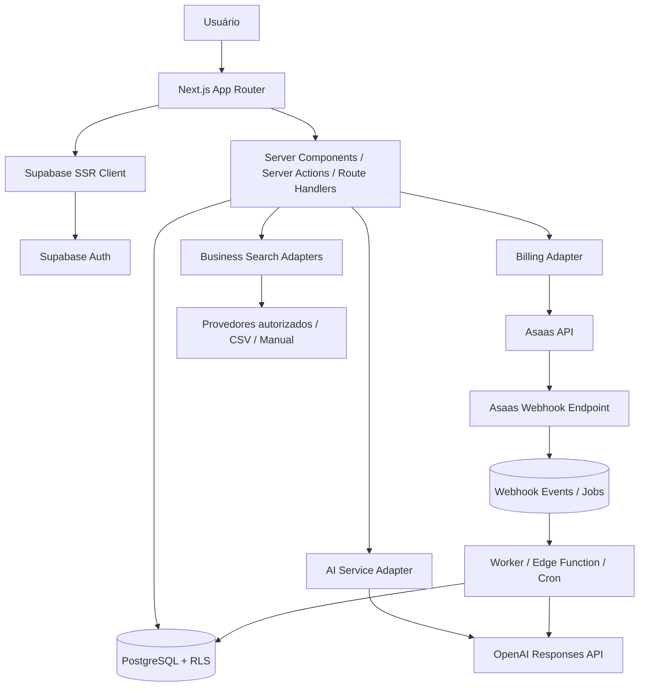

# 2. Arquitetura técnica

## 2.1. Decisão arquitetural

Adotar **monólito modular** em Next.js App Router com TypeScript, Supabase como backend gerenciado e integrações externas encapsuladas por adaptadores. Não introduzir microserviços no MVP. Essa abordagem reduz operação e mantém limites de domínio claros.

## 2.2. Stack definida

| Camada | Tecnologia | Observação |
|---|---|---|
| App web | Next.js App Router | Usar versão estável vigente na inicialização |
| Linguagem | TypeScript strict | Compartilhar tipos e schemas |
| UI | Tailwind CSS + shadcn/ui | Design system documentado |
| Formulários | React Hook Form + Zod | Validar no cliente e servidor |
| Auth | Supabase Auth | SSR com `@supabase/ssr` |
| Banco | Supabase PostgreSQL | RLS em todas as tabelas tenant-scoped |
| Storage | Supabase Storage | PDFs e uploads com políticas de acesso |
| Backend gerenciado | Supabase Edge Functions | Webhooks e workers quando fizer sentido |
| IA | OpenAI API | Responses API, Structured Outputs e tool calling |
| Billing | Asaas API | Checkout recorrente e webhooks |
| Testes | Vitest + Playwright | Unidade, integração e E2E |
| Hospedagem | Vercel + Supabase | Ambientes separados |

## 2.3. Visão de componentes



## 2.4. Limites de responsabilidade

### Next.js

- Renderização, layouts, navegação e componentes.
- Server Components para consultas de leitura quando apropriado.
- Server Actions/Route Handlers para operações autenticadas.
- Validação Zod no servidor.
- Nunca colocar secrets em variáveis `NEXT_PUBLIC_*`.

### Supabase

- Auth, PostgreSQL, RLS, Storage e migrações.
- Edge Functions para webhook e processamentos que devam ficar próximos ao Supabase.
- Cron/worker para trabalhos agendados e fila persistente.

### Integrações

- `OpenAIProvider`: chama OpenAI e normaliza respostas/uso.
- `AsaasProvider`: clientes, checkout, assinatura e consulta de cobranças.
- `BusinessDataProvider`: pesquisa e detalhes de empresas, com metadados de fonte.
- `CsvImportProvider`: importação e validação de arquivo.

## 2.5. Estrutura de pastas proposta

```text
src/
  app/
    (auth)/login/ register/ recovery/
    (workspace)/dashboard/ prospecting/ companies/ leads/ pipeline/
      assistant/ services/ proposals/ reports/ billing/ settings/
    api/
  components/
    ui/ layout/ dashboard/ prospecting/ crm/ assistant/ billing/
  modules/
    auth/ organizations/ prospecting/ companies/ leads/ activities/
    ai/ billing/ services/ proposals/ reports/ automations/
  lib/
    supabase/ auth/ permissions/ validation/ env/ logger/
  server/
    repositories/ services/ providers/ jobs/
  types/
supabase/
  migrations/
  functions/
  tests/
docs/
```

Manter regras de negócio fora dos componentes visuais. Os componentes não devem consultar diretamente um provedor externo.

## 2.6. Padrões de implementação

- Criar `createServerClient` e `createBrowserClient` conforme o padrão SSR vigente do Supabase.
- Consultas sensíveis sempre no servidor e sob sessão do usuário.
- Não usar Service Role Key no navegador.
- Toda query tenant-scoped recebe `organization_id` obtido da sessão/membership, nunca confiado apenas no body.
- Revalidar autorização na camada de serviço e deixar RLS como proteção adicional.
- Paginação por cursor ou range; padrão inicial de 25 itens.
- Ordenação/filtros com allowlist para evitar SQL injection.
- Transações ou funções SQL para operações que exigem consistência entre tabelas.
- Valores monetários em `numeric`, nunca float.
- Datas armazenadas em UTC (`timestamptz`) e apresentadas no timezone da organização.
- UUIDs como identificadores internos; IDs externos de provedores armazenados em campos próprios.

## 2.7. Processamento assíncrono

Pesquisas grandes, importações CSV, análise de lotes e automações não devem bloquear uma requisição HTTP longa.

Criar uma fila persistente `jobs` com:

- `id`, `organization_id`, `job_type`, `payload`, `status`, `attempts`, `max_attempts`, `run_after`, `locked_at`, `locked_by`, `last_error`, `created_at`, `completed_at`.
- Estados `queued`, `processing`, `succeeded`, `failed`, `dead_letter`.
- Claim atômico (por exemplo, função SQL com `FOR UPDATE SKIP LOCKED`).
- Retry com backoff exponencial e jitter.
- Idempotency key por job.
- Limite por organização e por provedor.
- DLQ e reprocessamento administrativo.

Um worker Edge Function ou processo controlado pode buscar jobs elegíveis. A estratégia final deve considerar limites de execução e runtime da plataforma. Não confiar em `setTimeout` ou execução em memória após responder HTTP.

## 2.8. Fluxos críticos

### Descoberta → lead

1. Usuário envia critérios.
2. Backend valida limites e permissões.
3. Search job é criado.
4. Provedor é consultado por adaptador.
5. Respostas são normalizadas e deduplicadas conforme regras/licença.
6. Resultado é exibido com atribuição e data da consulta.
7. Usuário seleciona um ou vários resultados.
8. Backend valida duplicidade e cria empresa/lead em transação.
9. Histórico é registrado.

### Análise IA

1. Usuário solicita análise de empresa/lead.
2. Backend confirma membership, plano e saldo de uso.
3. Busca dados permitidos e minimiza contexto.
4. Cria registro `ai_usage_events` pendente.
5. Chama OpenAI Responses API via adaptador.
6. Valida saída com Zod/JSON Schema.
7. Persiste análise e consumo real reportado.
8. Atualiza score somente mediante regra definida.
9. Exibe fatos, hipóteses, fontes e confiança.

### Assinatura Asaas

1. Usuário escolhe um plano.
2. Backend calcula preço a partir do catálogo interno; nunca aceita preço arbitrário do browser.
3. Cria/recupera customer no Asaas.
4. Cria checkout ou assinatura usando contrato vigente do Asaas.
5. Salva IDs externos e estado `incomplete`.
6. Redireciona para checkout hospedado.
7. Webhook autenticado é persistido antes da resposta.
8. Evento é processado de forma idempotente.
9. Assinatura e pagamentos são sincronizados.
10. Entitlements são recalculados.

## 2.9. Ambientes

- Local: Supabase CLI/local stack, `.env.local` e chaves de sandbox.
- Staging: projeto Supabase separado, URL de staging e Asaas Sandbox.
- Produção: projeto Supabase separado, domínio próprio, secrets de produção, Asaas produção e alertas.

Não compartilhar banco ou credenciais entre ambientes. Migrações versionadas no Git; alterações manuais de produção devem ser evitadas.

## 2.10. Variáveis de ambiente esperadas

```env
NEXT_PUBLIC_APP_URL=
NEXT_PUBLIC_SUPABASE_URL=
NEXT_PUBLIC_SUPABASE_PUBLISHABLE_KEY=
SUPABASE_SERVICE_ROLE_KEY=
OPENAI_API_KEY=
OPENAI_DEFAULT_MODEL=
ASAAS_API_KEY=
ASAAS_API_BASE_URL=
ASAAS_WEBHOOK_TOKEN=
ASAAS_ENVIRONMENT=sandbox
BUSINESS_PROVIDER=
BUSINESS_PROVIDER_API_KEY=
CRON_SECRET=
```

Nomes são uma proposta; conferir nomenclatura de chaves Supabase vigente e validar tudo com schema de ambiente. `SUPABASE_SERVICE_ROLE_KEY`, `OPENAI_API_KEY`, `ASAAS_API_KEY` e tokens de webhook são exclusivamente server-side.

## 2.11. ADRs (Architecture Decision Records)

- ADR-001: Next.js + Supabase como backend inicial; sem NestJS separado no MVP.
- ADR-002: multi-tenancy por `organization_id` com RLS.
- ADR-003: empresa descoberta separada de lead.
- ADR-004: OpenAI Responses API através de adaptador interno.
- ADR-005: Asaas cobra somente a assinatura do FinderFlow no MVP.
- ADR-006: aquisições externas respeitam licença, atribuição e retenção de cada fonte.
- ADR-007: ações externas e comunicações não são executadas pela IA sem autorização.
- ADR-008: tarefas demoradas utilizam fila persistente e idempotência.
