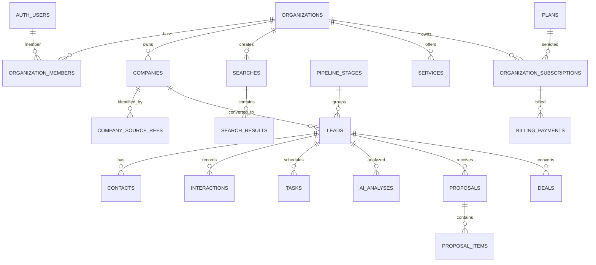

# 3. Modelo de dados e banco de dados

## 3.1. Convenções

- PostgreSQL gerenciado pelo Supabase.
- UUID como PK (`gen_random_uuid()`).
- `created_at` e `updated_at` em `timestamptz`.
- `numeric(12,2)` para valores monetários.
- `organization_id` em todas as tabelas de domínio tenant-scoped.
- FK com `ON DELETE` deliberado; evitar cascade em dados financeiros/auditoria.
- `jsonb` apenas para atributos variáveis/provedor; campos de filtro e relacionamento importantes devem ser colunas tipadas.
- Soft delete somente onde necessário, com `archived_at`/`deleted_at` e políticas claras.

## 3.2. Domínios e tabelas

### Identidade e tenant

| Tabela | Propósito | Campos centrais |
|---|---|---|
| `profiles` | Perfil global do usuário | `id` (ref auth.users), `full_name`, `avatar_url` |
| `organizations` | Workspace/cliente SaaS | `id`, `name`, `slug`, `timezone`, `settings` |
| `organization_members` | Associação e papel | `organization_id`, `user_id`, `role`, `status` |
| `organization_invitations` | Convites | `organization_id`, `email`, `role`, `token_hash`, `expires_at` |

### Catálogo e prospecção

| Tabela | Propósito | Campos centrais |
|---|---|---|
| `companies` | Empresa no workspace | `organization_id`, `name`, `normalized_name`, `category`, `cnpj`, `website`, `phone`, `email`, `address`, `social_links` |
| `company_source_refs` | IDs/metadados de fontes | `company_id`, `provider`, `external_id`, `attribution`, `fetched_at`, `retention_policy` |
| `searches` | Pesquisa executada/salva | `organization_id`, `created_by`, `query`, `segment`, `state`, `city`, `filters`, `status` |
| `search_results` | Resultado associado à pesquisa | `search_id`, `company_id`, `provider`, `external_id`, `display_data`, `fetched_at`, `expires_at` |
| `import_jobs` | Importação de planilha | `organization_id`, `file_path`, `status`, `summary`, `error_report` |

### CRM

| Tabela | Propósito | Campos centrais |
|---|---|---|
| `pipeline_stages` | Etapas customizáveis | `organization_id`, `name`, `position`, `color`, `is_closed`, `result_type` |
| `leads` | Oportunidade comercial | `organization_id`, `company_id`, `stage_id`, `assigned_to`, `score`, `priority`, `estimated_value`, `probability`, `next_contact_at`, `loss_reason` |
| `contacts` | Pessoas de contato | `organization_id`, `company_id`, `name`, `role`, `email`, `phone`, `preferred_channel` |
| `interactions` | Timeline | `organization_id`, `lead_id`, `actor_id`, `type`, `channel`, `content_summary`, `occurred_at` |
| `tasks` | Próximas ações | `organization_id`, `lead_id`, `assigned_to`, `title`, `due_at`, `status`, `completed_at` |
| `lead_stage_history` | Auditoria de pipeline | `lead_id`, `from_stage_id`, `to_stage_id`, `changed_by`, `changed_at` |
| `suppression_entries` | Não contatar | `organization_id`, `contact_value_hash`, `reason`, `source`, `created_at` |

### Serviços e vendas

| Tabela | Propósito | Campos centrais |
|---|---|---|
| `services` | Catálogo do assinante | `organization_id`, `name`, `description`, `base_price`, `pricing_type`, `active` |
| `proposals` | Propostas | `organization_id`, `lead_id`, `number`, `status`, `total_amount`, `valid_until`, `document_path` |
| `proposal_items` | Itens | `proposal_id`, `service_id`, `description`, `quantity`, `unit_price`, `total` |
| `deals` | Negócios | `organization_id`, `lead_id`, `proposal_id`, `status`, `amount`, `expected_close_at`, `closed_at` |

### IA

| Tabela | Propósito | Campos centrais |
|---|---|---|
| `ai_analyses` | Análises persistidas | `organization_id`, `company_id`, `lead_id`, `analysis_type`, `result`, `score`, `confidence`, `sources`, `model`, `prompt_version` |
| `ai_conversations` | Conversas | `organization_id`, `user_id`, `title`, `status` |
| `ai_messages` | Mensagens | `conversation_id`, `role`, `content`, `tool_calls`, `created_at` |
| `ai_prompt_versions` | Prompts versionados | `prompt_key`, `version`, `content`, `output_schema`, `model_config`, `active` |
| `ai_usage_events` | Uso e custo | `organization_id`, `user_id`, `model`, `operation`, `input_tokens`, `output_tokens`, `estimated_cost`, `status` |

### Billing do FinderFlow

| Tabela | Propósito | Campos centrais |
|---|---|---|
| `plans` | Catálogo comercial do SaaS | `slug`, `name`, `price`, `interval`, `limits`, `features`, `active` |
| `organization_subscriptions` | Assinatura por workspace | `organization_id`, `plan_id`, `provider`, `external_customer_id`, `external_subscription_id`, `status`, `period_start`, `period_end`, `cancel_at_period_end` |
| `billing_payments` | Cobranças da assinatura SaaS | `subscription_id`, `external_payment_id`, `amount`, `status`, `due_date`, `paid_at`, `invoice_url` |
| `asaas_webhook_events` | Inbox idempotente de eventos | `provider_event_id` UNIQUE, `event_type`, `payload`, `status`, `attempts`, `received_at`, `processed_at` |
| `entitlements` | Recursos/limites calculados | `organization_id`, `feature_key`, `limit_value`, `period_start`, `period_end` |

### Plataforma

| Tabela | Propósito |
|---|---|
| `jobs` | Fila persistente de tarefas |
| `automation_rules` | Gatilhos e ações |
| `automation_runs` | Execuções de automação |
| `notifications` | Notificações in-app |
| `integration_connections` | Configuração/estado de integrações; secrets fora do banco sempre que possível |
| `audit_logs` | Eventos administrativos e comerciais |

## 3.3. Relacionamentos principais

## 3.4. Índices e constraints essenciais

- `organization_members (organization_id, user_id)` UNIQUE.
- `organizations (slug)` UNIQUE.
- `companies (organization_id, normalized_name)` INDEX; não assumir que nome seja identificador único.
- `company_source_refs (provider, external_id, company_id)` com estratégia de unicidade conforme regras do provedor.
- `leads (organization_id, company_id)` UNIQUE para leads não arquivados, via índice parcial quando `archived_at IS NULL`.
- `leads (organization_id, stage_id, updated_at)` INDEX.
- `tasks (organization_id, status, due_at)` INDEX.
- `searches (organization_id, created_at DESC)` INDEX.
- `ai_usage_events (organization_id, created_at DESC)` INDEX.
- `asaas_webhook_events (provider_event_id)` UNIQUE para idempotência.
- `jobs (status, run_after)` INDEX parcial para jobs pendentes.
- Todas as FKs usadas em joins e RLS devem ter índices quando apropriado.

Deduplicação deve usar sinais combinados (CNPJ quando confiável, identificador do provedor, telefone, domínio e nome/endereço), com score de confiança e revisão em casos ambíguos. Não fundir empresas automaticamente apenas pelo nome.

## 3.5. Estratégia de RLS

1. Criar função `is_org_member(target_org uuid)` com `SECURITY DEFINER`, `search_path` fixo e privilégios mínimos para evitar recursão das policies.
2. Criar função `has_org_role(target_org uuid, allowed_roles text[])` para operações administrativas.
3. Ativar RLS em todas as tabelas tenant-scoped.
4. Políticas `SELECT`, `INSERT`, `UPDATE` e `DELETE` separadas, sempre verificando organização e papel.
5. `organization_id` de inserts é derivado/verificado pelo servidor; não aceitar associação arbitrária enviada pelo browser.
6. Tabelas globais controladas (por exemplo `plans`) podem ter leitura autenticada e escrita restrita a serviço/admin.
7. Secrets nunca são armazenados em tabelas acessíveis ao cliente. Se uma credencial de integração por tenant for necessária futuramente, armazenar cifrada ou em vault apropriado.
8. Testar RLS com dois usuários em duas organizações e papéis diferentes.

## 3.6. Dados de fontes externas

O contrato de cada provedor deve declarar: dados retornados, atribuição necessária, cache permitido, prazo de retenção, uso comercial permitido e custo. Para Google Places, não assumir liberdade geral de cache: o Place ID tem exceção específica, mas outros campos possuem restrições. Para OpenStreetMap, não usar o endpoint público do Nominatim para pesquisa em massa de um SaaS; optar por serviço contratado/instância apropriada e cumprir atribuição e política. Persistir somente o que a licença autorizar.

## 3.7. Separação financeira

`billing_payments` registra exclusivamente cobranças da assinatura do FinderFlow. Valores que o assinante vende aos seus próprios clientes ficam em `deals` e `proposals`. Uma futura conexão Asaas por tenant terá tabelas e credenciais próprias, com isolamento estrito, fora do MVP.

## 3.8. Migration de referência

Consulte `database/001_core_schema.sql`. Ela é uma base inicial, não substitui revisão, novas migrations incrementais nem testes RLS. O Claude deverá revisar constraints, roles e políticas no contexto da versão Supabase usada.
