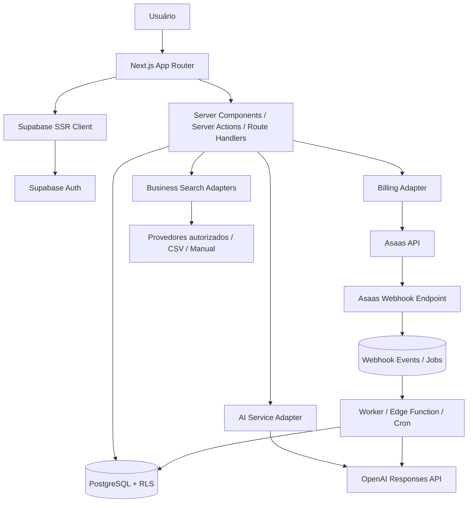
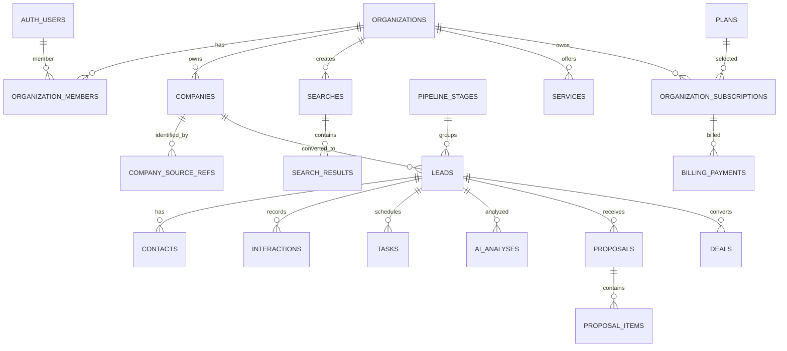
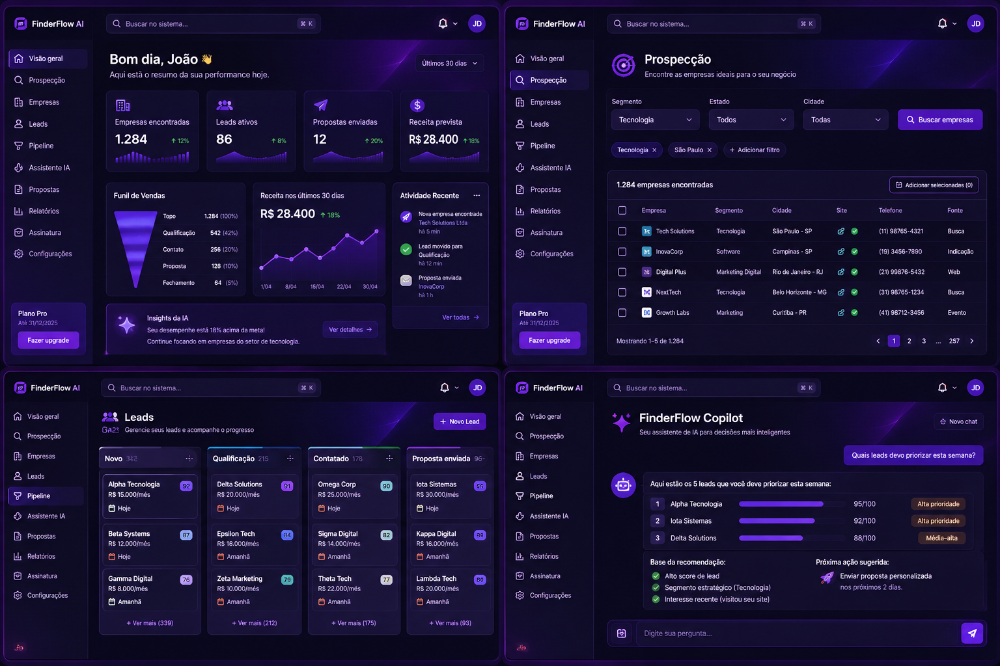

# Controle do documento

| Campo | Valor |
|---|---|
| Produto | FinderFlow AI |
| Versão | 1.0 |
| Status | Baseline para início da implementação |
| Modelo | SaaS multi-tenant |
| Stack | Next.js + Supabase + OpenAI + Asaas |
| Idioma | Português do Brasil |

# Índice

1. Requisitos do produto (PRD)
2. Arquitetura técnica
3. Modelo de dados e banco de dados
4. Contratos de API
5. Integrações externas
6. Design system e telas de referência
7. Backlog e critérios de aceite
8. Segurança e operação

---

# 1. Documento de Requisitos do Produto (PRD)

## 1.1. Resumo executivo

O **FinderFlow AI** é uma plataforma SaaS multi-tenant que ajuda profissionais e pequenas empresas B2B a descobrir empresas, avaliar oportunidades comerciais, organizar leads, preparar abordagens, acompanhar negociações e analisar resultados. A plataforma combina um CRM leve, uma central de prospecção com fontes híbridas de dados e um motor de IA baseado na OpenAI API. As assinaturas do próprio FinderFlow serão cobradas pelo Asaas.

**Proposta de valor:** transformar a prospecção B2B em um processo organizado, assistido por IA, mensurável e repetível.

## 1.2. Problema

A prospecção costuma estar fragmentada entre buscadores, diretórios, planilhas, WhatsApp, e-mail e ferramentas de CRM. O usuário perde tempo encontrando empresas, avaliando presença digital, criando mensagens e lembrando quando retomar uma conversa. O FinderFlow centraliza esse fluxo, preservando a decisão humana em ações comerciais sensíveis.

## 1.3. Objetivos

1. Diminuir o tempo de descoberta e triagem de empresas.
2. Aumentar a qualidade e rastreabilidade da qualificação comercial.
3. Centralizar empresas, leads, contatos, atividades, propostas e negócios.
4. Utilizar IA para análise, priorização e preparação de comunicações.
5. Automatizar tarefas e lembretes sem disparo indiscriminado de mensagens.
6. Monetizar o produto com planos e assinaturas recorrentes via Asaas.
7. Preparar arquitetura e segurança para múltiplas organizações e equipes.

## 1.4. Não objetivos do MVP

- Envio em massa ou automação não solicitada de mensagens.
- Scraping indiscriminado de Google Maps, Instagram, LinkedIn ou outros serviços.
- Sistema fiscal/contábil completo.
- Gestão de projetos de software dos clientes finais.
- Marketplace de freelancers.
- Aplicativo mobile nativo.
- Processamento de pagamentos dos clientes dos assinantes. No MVP, o Asaas cobra apenas a assinatura do FinderFlow.

## 1.5. Público-alvo e personas

### Persona A — profissional autônomo

Precisa encontrar empresas e vender serviços com pouco tempo e orçamento. Quer pesquisar segmentos e cidades, salvar leads e receber ajuda para abordar cada oportunidade.

### Persona B — agência ou pequena software house

Possui mais de um vendedor ou responsável comercial, precisa distribuir leads, acompanhar pipeline, padronizar propostas e medir conversão.

### Persona C — consultoria/serviços B2B

Vende serviços configuráveis (marketing, automação, design, tecnologia ou consultoria) e precisa descobrir empresas que tenham aderência ao portfólio.

## 1.6. Princípios do produto

- **Empresa encontrada não é automaticamente lead.** Uma empresa só entra no CRM quando o usuário decide convertê-la.
- **Fatos separados de hipóteses.** A IA deve indicar evidências, origem e confiança, sem apresentar inferências como fatos.
- **Humano no controle.** Mensagens e propostas geradas por IA precisam de revisão; ações externas exigem autorização explícita.
- **Privacidade por organização.** Todos os dados de negócio são isolados por `organization_id` e RLS.
- **Provedor substituível.** Aquisição de dados, IA e pagamentos devem ter adaptadores próprios.
- **MVP enxuto.** Monólito modular antes de microserviços.

## 1.7. Módulos funcionais

### MOD-01 — Autenticação e organizações

Cadastro, login, recuperação de senha, verificação de e-mail, perfil, criação de organização, convites e papéis. Papéis iniciais: `owner`, `admin`, `manager`, `member`, `viewer`.

### MOD-02 — Dashboard

Cards de empresas encontradas, leads ativos, leads qualificados, contatos realizados, propostas enviadas, negócios ganhos, conversão, pipeline ponderado e receita conquistada. Exibir evolução por período, funil, distribuição por segmento, tarefas pendentes, leads parados e resumo de IA. Diferenciar receita contratada, faturada e recebida.

### MOD-03 — Central de prospecção

Pesquisa por segmento, termo, estado, cidade e filtros suportados pela fonte. Exibir empresa, categoria, endereço, telefone, website, redes sociais, avaliação e fonte, quando fornecidos legalmente. Suportar resultados paginados, seleção simples/múltipla, pesquisas salvas, histórico, exportação permitida, importação CSV e cadastro manual. Mostrar data da consulta e limitações da fonte.

### MOD-04 — Empresas e CRM

Cadastro e detalhes da empresa; conversão explícita em lead; deduplicação; pipeline Kanban e tabela; responsáveis; prioridade; serviço de interesse; valor estimado; probabilidade; próxima ação; timeline de interações; tarefas e notas; motivos de perda; reabertura controlada.

Etapas padrão: Novo, Qualificação, Preparar abordagem, Contatado, Em conversa, Reunião agendada, Proposta enviada, Negociação, Ganho e Perdido. As etapas devem ser configuráveis por organização.

### MOD-05 — AI Engine

- Company Analyzer: análise de presença e contexto empresarial.
- Lead Scorer: score explicável de 0 a 100.
- Opportunity Engine: sugestão de serviço aderente.
- Outreach Generator: rascunhos de abordagem por canal e tom.
- Follow-up Assistant: sugestão de próximo contato.
- Proposal Assistant: rascunho de escopo e proposta.
- Sales Analyst: interpretação de métricas.
- CRM Copilot: assistente conversacional com ferramentas internas autorizadas.

### MOD-06 — Atividades e relacionamento

Tarefas, lembretes, interações, reuniões, notas, canais de contato, histórico e notificações. Uma interação deve registrar autor, data/hora, canal, tipo e descrição. Não armazenar conteúdo excessivo ou sensível sem finalidade.

### MOD-07 — Serviços, propostas e negócios

Catálogo de serviços configurável, preços e modelos de precificação; propostas com itens, validade, status e PDF; negócios vinculados a leads e propostas; status ganho/perdido; valores previstos e efetivos. Os valores registrados pelo usuário não são cobranças do FinderFlow.

### MOD-08 — Automações

Gatilhos internos: lead criado, score atualizado, etapa alterada, tarefa vencida, proposta enviada, negócio ganho/perdido. Ações: criar tarefa, notificar, solicitar análise IA e atualizar campos permitidos. Regras precisam ser auditáveis, limitadas por plano e possuir prevenção de loops.

### MOD-09 — Relatórios

Conversão por período, segmento, serviço, origem, responsável e etapa; tempo médio de ciclo; ticket médio; motivo de perda; produtividade e consumo de IA.

### MOD-10 — Billing e gestão SaaS

Planos, checkout recorrente, assinatura, pagamentos, inadimplência, período de tolerância, cancelamento, upgrade/downgrade, limites e histórico financeiro do assinante via Asaas. O status da assinatura é atualizado por webhook autenticado e idempotente; não pelo retorno de navegador.

## 1.8. Requisitos funcionais numerados

| ID | Requisito | Prioridade |
|---|---|---|
| RF-001 | Cadastrar, autenticar e recuperar conta | P0 |
| RF-002 | Criar organização e vincular membros | P0 |
| RF-003 | Aplicar papéis e permissões | P0 |
| RF-004 | Isolar dados por organização com RLS | P0 |
| RF-005 | Consultar dashboard por período | P1 |
| RF-006 | Pesquisar empresas por segmento e localidade | P0 |
| RF-007 | Importar empresas por CSV | P0 |
| RF-008 | Cadastrar empresa manualmente | P0 |
| RF-009 | Normalizar e deduplicar empresas | P0 |
| RF-010 | Guardar pesquisas e resultados permitidos | P0 |
| RF-011 | Converter empresa selecionada em lead | P0 |
| RF-012 | Visualizar leads em Kanban e tabela | P0 |
| RF-013 | Criar/editar etapas do pipeline | P1 |
| RF-014 | Registrar contatos e interações | P0 |
| RF-015 | Criar tarefas e lembretes | P0 |
| RF-016 | Analisar empresa com OpenAI | P0 |
| RF-017 | Gerar score explicável | P0 |
| RF-018 | Gerar rascunho de abordagem | P0 |
| RF-019 | Conversar com CRM Copilot | P1 |
| RF-020 | Executar ferramentas do assistente com autorização | P1 |
| RF-021 | Cadastrar serviços | P1 |
| RF-022 | Criar propostas e negócios | P1 |
| RF-023 | Contratar plano via Asaas | P0 |
| RF-024 | Receber e processar webhook Asaas | P0 |
| RF-025 | Controlar limites e consumo por plano | P0 |
| RF-026 | Consultar histórico de pagamentos | P1 |
| RF-027 | Registrar logs de auditoria | P0 |
| RF-028 | Exportar dados da organização | P1 |
| RF-029 | Registrar origem, licença e data da fonte | P0 |
| RF-030 | Gerenciar lista de supressão/oposição a contato | P1 |

## 1.9. Requisitos não funcionais

- Responsividade para desktop, tablet e celular.
- Acessibilidade: navegação por teclado, contraste adequado, labels e estados de foco.
- Segurança: RLS, RBAC, validação de entrada, rate limiting e gestão de segredos.
- Disponibilidade: tratamento de falhas externas e degradação graciosa.
- Performance: paginação no servidor; evitar carregar listas completas; índices de filtros.
- Observabilidade: logs estruturados, correlation IDs e monitoramento de tarefas.
- Manutenibilidade: TypeScript estrito, módulos, testes e documentação.
- Integridade: transações para operações comerciais críticas e idempotência para webhooks.
- Privacidade: minimização, retenção, exportação e exclusão conforme política.

## 1.10. Regras de negócio

1. Um resultado de pesquisa só vira lead após ação explícita do usuário.
2. Uma organização não acessa registros de outra organização.
3. Um lead pertence a uma organização e referencia uma empresa dessa organização.
4. Deve existir no máximo um lead ativo por empresa e organização; casos de duplicidade devem permitir revisão/reabertura controlada.
5. Mudança de etapa gera evento de histórico.
6. Ganho/perda exige registro de encerramento e, quando perdido, motivo recomendado.
7. Score não equivale à probabilidade de compra. Probabilidade comercial é campo separado e editável.
8. Toda análise IA registra modelo, versão de prompt, fontes, uso e resultado.
9. Comunicação gerada pela IA é rascunho até aprovação humana.
10. A assinatura do FinderFlow só muda após confirmação verificada do provedor ou ação administrativa auditada.
11. Webhooks podem ser recebidos mais de uma vez; processar de forma idempotente.
12. Limites são verificados no backend, antes de consumir APIs pagas.
13. Dados externos só são armazenados pelo período e forma permitidos pelo provedor.
14. Solicitações de não contato devem ser respeitadas e aplicadas em toda futura campanha/abordagem.

## 1.11. Métricas de sucesso do produto

- Tempo mediano entre pesquisa e criação de lead.
- Percentual de resultados convertidos em leads.
- Percentual de leads que recebem primeiro contato.
- Taxa de resposta por canal (quando registrada).
- Conversão de lead em negócio ganho.
- Tempo médio até fechamento.
- Custo de IA por organização e por tarefa.
- Custo de dados por pesquisa e por lead convertido.
- Retenção, churn e receita recorrente do FinderFlow.

## 1.12. Critérios de aceite do MVP

O MVP é aceito quando: (a) cadastro/login e organização funcionam; (b) RLS impede leitura cruzada; (c) cadastro manual e CSV funcionam; (d) existe ao menos um provedor real de pesquisa integrado e validado; (e) empresa pode virar lead sem duplicar; (f) pipeline e timeline funcionam; (g) análise e mensagem IA são persistidas; (h) plano e checkout de teste funcionam em Asaas Sandbox; (i) webhook autenticado e idempotente atualiza assinatura; (j) limites de plano são verificados no servidor; (k) testes automatizados cobrem os fluxos críticos.


---


# 2. Arquitetura técnica

## 2.1. Decisão arquitetural

Adotar **monólito modular** em Next.js App Router com TypeScript, Supabase como backend gerenciado e integrações externas encapsuladas por adaptadores. Não introduzir microserviços no MVP. Essa abordagem reduz operação e mantém limites de domínio claros.

## 2.2. Stack definida

| Camada | Tecnologia | Observação |
|---|---|---|
| App web | Next.js App Router | Usar versão estável vigente na inicialização |
| Linguagem | TypeScript strict | Compartilhar tipos e schemas |
| UI | Tailwind CSS + shadcn/ui | Design system documentado |
| Formulários | React Hook Form + Zod | Validar no cliente e servidor |
| Auth | Supabase Auth | SSR com `@supabase/ssr` |
| Banco | Supabase PostgreSQL | RLS em todas as tabelas tenant-scoped |
| Storage | Supabase Storage | PDFs e uploads com políticas de acesso |
| Backend gerenciado | Supabase Edge Functions | Webhooks e workers quando fizer sentido |
| IA | OpenAI API | Responses API, Structured Outputs e tool calling |
| Billing | Asaas API | Checkout recorrente e webhooks |
| Testes | Vitest + Playwright | Unidade, integração e E2E |
| Hospedagem | Vercel + Supabase | Ambientes separados |

## 2.3. Visão de componentes



## 2.4. Limites de responsabilidade

### Next.js

- Renderização, layouts, navegação e componentes.
- Server Components para consultas de leitura quando apropriado.
- Server Actions/Route Handlers para operações autenticadas.
- Validação Zod no servidor.
- Nunca colocar secrets em variáveis `NEXT_PUBLIC_*`.

### Supabase

- Auth, PostgreSQL, RLS, Storage e migrações.
- Edge Functions para webhook e processamentos que devam ficar próximos ao Supabase.
- Cron/worker para trabalhos agendados e fila persistente.

### Integrações

- `OpenAIProvider`: chama OpenAI e normaliza respostas/uso.
- `AsaasProvider`: clientes, checkout, assinatura e consulta de cobranças.
- `BusinessDataProvider`: pesquisa e detalhes de empresas, com metadados de fonte.
- `CsvImportProvider`: importação e validação de arquivo.

## 2.5. Estrutura de pastas proposta

```text
src/
  app/
    (auth)/login/ register/ recovery/
    (workspace)/dashboard/ prospecting/ companies/ leads/ pipeline/
      assistant/ services/ proposals/ reports/ billing/ settings/
    api/
  components/
    ui/ layout/ dashboard/ prospecting/ crm/ assistant/ billing/
  modules/
    auth/ organizations/ prospecting/ companies/ leads/ activities/
    ai/ billing/ services/ proposals/ reports/ automations/
  lib/
    supabase/ auth/ permissions/ validation/ env/ logger/
  server/
    repositories/ services/ providers/ jobs/
  types/
supabase/
  migrations/
  functions/
  tests/
docs/
```

Manter regras de negócio fora dos componentes visuais. Os componentes não devem consultar diretamente um provedor externo.

## 2.6. Padrões de implementação

- Criar `createServerClient` e `createBrowserClient` conforme o padrão SSR vigente do Supabase.
- Consultas sensíveis sempre no servidor e sob sessão do usuário.
- Não usar Service Role Key no navegador.
- Toda query tenant-scoped recebe `organization_id` obtido da sessão/membership, nunca confiado apenas no body.
- Revalidar autorização na camada de serviço e deixar RLS como proteção adicional.
- Paginação por cursor ou range; padrão inicial de 25 itens.
- Ordenação/filtros com allowlist para evitar SQL injection.
- Transações ou funções SQL para operações que exigem consistência entre tabelas.
- Valores monetários em `numeric`, nunca float.
- Datas armazenadas em UTC (`timestamptz`) e apresentadas no timezone da organização.
- UUIDs como identificadores internos; IDs externos de provedores armazenados em campos próprios.

## 2.7. Processamento assíncrono

Pesquisas grandes, importações CSV, análise de lotes e automações não devem bloquear uma requisição HTTP longa.

Criar uma fila persistente `jobs` com:

- `id`, `organization_id`, `job_type`, `payload`, `status`, `attempts`, `max_attempts`, `run_after`, `locked_at`, `locked_by`, `last_error`, `created_at`, `completed_at`.
- Estados `queued`, `processing`, `succeeded`, `failed`, `dead_letter`.
- Claim atômico (por exemplo, função SQL com `FOR UPDATE SKIP LOCKED`).
- Retry com backoff exponencial e jitter.
- Idempotency key por job.
- Limite por organização e por provedor.
- DLQ e reprocessamento administrativo.

Um worker Edge Function ou processo controlado pode buscar jobs elegíveis. A estratégia final deve considerar limites de execução e runtime da plataforma. Não confiar em `setTimeout` ou execução em memória após responder HTTP.

## 2.8. Fluxos críticos

### Descoberta → lead

1. Usuário envia critérios.
2. Backend valida limites e permissões.
3. Search job é criado.
4. Provedor é consultado por adaptador.
5. Respostas são normalizadas e deduplicadas conforme regras/licença.
6. Resultado é exibido com atribuição e data da consulta.
7. Usuário seleciona um ou vários resultados.
8. Backend valida duplicidade e cria empresa/lead em transação.
9. Histórico é registrado.

### Análise IA

1. Usuário solicita análise de empresa/lead.
2. Backend confirma membership, plano e saldo de uso.
3. Busca dados permitidos e minimiza contexto.
4. Cria registro `ai_usage_events` pendente.
5. Chama OpenAI Responses API via adaptador.
6. Valida saída com Zod/JSON Schema.
7. Persiste análise e consumo real reportado.
8. Atualiza score somente mediante regra definida.
9. Exibe fatos, hipóteses, fontes e confiança.

### Assinatura Asaas

1. Usuário escolhe um plano.
2. Backend calcula preço a partir do catálogo interno; nunca aceita preço arbitrário do browser.
3. Cria/recupera customer no Asaas.
4. Cria checkout ou assinatura usando contrato vigente do Asaas.
5. Salva IDs externos e estado `incomplete`.
6. Redireciona para checkout hospedado.
7. Webhook autenticado é persistido antes da resposta.
8. Evento é processado de forma idempotente.
9. Assinatura e pagamentos são sincronizados.
10. Entitlements são recalculados.

## 2.9. Ambientes

- Local: Supabase CLI/local stack, `.env.local` e chaves de sandbox.
- Staging: projeto Supabase separado, URL de staging e Asaas Sandbox.
- Produção: projeto Supabase separado, domínio próprio, secrets de produção, Asaas produção e alertas.

Não compartilhar banco ou credenciais entre ambientes. Migrações versionadas no Git; alterações manuais de produção devem ser evitadas.

## 2.10. Variáveis de ambiente esperadas

```env
NEXT_PUBLIC_APP_URL=
NEXT_PUBLIC_SUPABASE_URL=
NEXT_PUBLIC_SUPABASE_PUBLISHABLE_KEY=
SUPABASE_SERVICE_ROLE_KEY=
OPENAI_API_KEY=
OPENAI_DEFAULT_MODEL=
ASAAS_API_KEY=
ASAAS_API_BASE_URL=
ASAAS_WEBHOOK_TOKEN=
ASAAS_ENVIRONMENT=sandbox
BUSINESS_PROVIDER=minha_receita
BUSINESS_PROVIDER_API_KEY=
BUSINESS_PROVIDER_BASE_URL=
CRON_SECRET=
```

Nota (atualizado após a Fase 8): `BUSINESS_PROVIDER=minha_receita` já
integra um provedor real — ver `docs/DECISIONS.md` e
`src/modules/companies/providers/`.

Nomes são uma proposta; conferir nomenclatura de chaves Supabase vigente e validar tudo com schema de ambiente. `SUPABASE_SERVICE_ROLE_KEY`, `OPENAI_API_KEY`, `ASAAS_API_KEY` e tokens de webhook são exclusivamente server-side.

## 2.11. ADRs (Architecture Decision Records)

- ADR-001: Next.js + Supabase como backend inicial; sem NestJS separado no MVP.
- ADR-002: multi-tenancy por `organization_id` com RLS.
- ADR-003: empresa descoberta separada de lead.
- ADR-004: OpenAI Responses API através de adaptador interno.
- ADR-005: Asaas cobra somente a assinatura do FinderFlow no MVP.
- ADR-006: aquisições externas respeitam licença, atribuição e retenção de cada fonte.
- ADR-007: ações externas e comunicações não são executadas pela IA sem autorização.
- ADR-008: tarefas demoradas utilizam fila persistente e idempotência.


---


# 3. Modelo de dados e banco de dados

## 3.1. Convenções

- PostgreSQL gerenciado pelo Supabase.
- UUID como PK (`gen_random_uuid()`).
- `created_at` e `updated_at` em `timestamptz`.
- `numeric(12,2)` para valores monetários.
- `organization_id` em todas as tabelas de domínio tenant-scoped.
- FK com `ON DELETE` deliberado; evitar cascade em dados financeiros/auditoria.
- `jsonb` apenas para atributos variáveis/provedor; campos de filtro e relacionamento importantes devem ser colunas tipadas.
- Soft delete somente onde necessário, com `archived_at`/`deleted_at` e políticas claras.

## 3.2. Domínios e tabelas

### Identidade e tenant

| Tabela | Propósito | Campos centrais |
|---|---|---|
| `profiles` | Perfil global do usuário | `id` (ref auth.users), `full_name`, `avatar_url` |
| `organizations` | Workspace/cliente SaaS | `id`, `name`, `slug`, `timezone`, `settings` |
| `organization_members` | Associação e papel | `organization_id`, `user_id`, `role`, `status` |
| `organization_invitations` | Convites | `organization_id`, `email`, `role`, `token_hash`, `expires_at` |

### Catálogo e prospecção

| Tabela | Propósito | Campos centrais |
|---|---|---|
| `companies` | Empresa no workspace | `organization_id`, `name`, `normalized_name`, `category`, `cnpj`, `website`, `phone`, `email`, `address`, `social_links` |
| `company_source_refs` | IDs/metadados de fontes | `company_id`, `provider`, `external_id`, `attribution`, `fetched_at`, `retention_policy` |
| `searches` | Pesquisa executada/salva | `organization_id`, `created_by`, `query`, `segment`, `state`, `city`, `filters`, `status` |
| `search_results` | Resultado associado à pesquisa | `search_id`, `company_id`, `provider`, `external_id`, `display_data`, `fetched_at`, `expires_at` |
| `import_jobs` | Importação de planilha | `organization_id`, `file_path`, `status`, `summary`, `error_report` |

### CRM

| Tabela | Propósito | Campos centrais |
|---|---|---|
| `pipeline_stages` | Etapas customizáveis | `organization_id`, `name`, `position`, `color`, `is_closed`, `result_type` |
| `leads` | Oportunidade comercial | `organization_id`, `company_id`, `stage_id`, `assigned_to`, `score`, `priority`, `estimated_value`, `probability`, `next_contact_at`, `loss_reason` |
| `contacts` | Pessoas de contato | `organization_id`, `company_id`, `name`, `role`, `email`, `phone`, `preferred_channel` |
| `interactions` | Timeline | `organization_id`, `lead_id`, `actor_id`, `type`, `channel`, `content_summary`, `occurred_at` |
| `tasks` | Próximas ações | `organization_id`, `lead_id`, `assigned_to`, `title`, `due_at`, `status`, `completed_at` |
| `lead_stage_history` | Auditoria de pipeline | `lead_id`, `from_stage_id`, `to_stage_id`, `changed_by`, `changed_at` |
| `suppression_entries` | Não contatar | `organization_id`, `contact_value_hash`, `reason`, `source`, `created_at` |

### Serviços e vendas

| Tabela | Propósito | Campos centrais |
|---|---|---|
| `services` | Catálogo do assinante | `organization_id`, `name`, `description`, `base_price`, `pricing_type`, `active` |
| `proposals` | Propostas | `organization_id`, `lead_id`, `number`, `status`, `total_amount`, `valid_until`, `document_path` |
| `proposal_items` | Itens | `proposal_id`, `service_id`, `description`, `quantity`, `unit_price`, `total` |
| `deals` | Negócios | `organization_id`, `lead_id`, `proposal_id`, `status`, `amount`, `expected_close_at`, `closed_at` |

### IA

| Tabela | Propósito | Campos centrais |
|---|---|---|
| `ai_analyses` | Análises persistidas | `organization_id`, `company_id`, `lead_id`, `analysis_type`, `result`, `score`, `confidence`, `sources`, `model`, `prompt_version` |
| `ai_conversations` | Conversas | `organization_id`, `user_id`, `title`, `status` |
| `ai_messages` | Mensagens | `conversation_id`, `role`, `content`, `tool_calls`, `created_at` |
| `ai_prompt_versions` | Prompts versionados | `prompt_key`, `version`, `content`, `output_schema`, `model_config`, `active` |
| `ai_usage_events` | Uso e custo | `organization_id`, `user_id`, `model`, `operation`, `input_tokens`, `output_tokens`, `estimated_cost`, `status` |

### Billing do FinderFlow

| Tabela | Propósito | Campos centrais |
|---|---|---|
| `plans` | Catálogo comercial do SaaS | `slug`, `name`, `price`, `interval`, `limits`, `features`, `active` |
| `organization_subscriptions` | Assinatura por workspace | `organization_id`, `plan_id`, `provider`, `external_customer_id`, `external_subscription_id`, `status`, `period_start`, `period_end`, `cancel_at_period_end` |
| `billing_payments` | Cobranças da assinatura SaaS | `subscription_id`, `external_payment_id`, `amount`, `status`, `due_date`, `paid_at`, `invoice_url` |
| `asaas_webhook_events` | Inbox idempotente de eventos | `provider_event_id` UNIQUE, `event_type`, `payload`, `status`, `attempts`, `received_at`, `processed_at` |
| `entitlements` | Recursos/limites calculados | `organization_id`, `feature_key`, `limit_value`, `period_start`, `period_end` |

### Plataforma

| Tabela | Propósito |
|---|---|
| `jobs` | Fila persistente de tarefas |
| `automation_rules` | Gatilhos e ações |
| `automation_runs` | Execuções de automação |
| `notifications` | Notificações in-app |
| `integration_connections` | Configuração/estado de integrações; secrets fora do banco sempre que possível |
| `audit_logs` | Eventos administrativos e comerciais |

## 3.3. Relacionamentos principais



## 3.4. Índices e constraints essenciais

- `organization_members (organization_id, user_id)` UNIQUE.
- `organizations (slug)` UNIQUE.
- `companies (organization_id, normalized_name)` INDEX; não assumir que nome seja identificador único.
- `company_source_refs (provider, external_id, company_id)` com estratégia de unicidade conforme regras do provedor.
- `leads (organization_id, company_id)` UNIQUE para leads não arquivados, via índice parcial quando `archived_at IS NULL`.
- `leads (organization_id, stage_id, updated_at)` INDEX.
- `tasks (organization_id, status, due_at)` INDEX.
- `searches (organization_id, created_at DESC)` INDEX.
- `ai_usage_events (organization_id, created_at DESC)` INDEX.
- `asaas_webhook_events (provider_event_id)` UNIQUE para idempotência.
- `jobs (status, run_after)` INDEX parcial para jobs pendentes.
- Todas as FKs usadas em joins e RLS devem ter índices quando apropriado.

Deduplicação deve usar sinais combinados (CNPJ quando confiável, identificador do provedor, telefone, domínio e nome/endereço), com score de confiança e revisão em casos ambíguos. Não fundir empresas automaticamente apenas pelo nome.

## 3.5. Estratégia de RLS

1. Criar função `is_org_member(target_org uuid)` com `SECURITY DEFINER`, `search_path` fixo e privilégios mínimos para evitar recursão das policies.
2. Criar função `has_org_role(target_org uuid, allowed_roles text[])` para operações administrativas.
3. Ativar RLS em todas as tabelas tenant-scoped.
4. Políticas `SELECT`, `INSERT`, `UPDATE` e `DELETE` separadas, sempre verificando organização e papel.
5. `organization_id` de inserts é derivado/verificado pelo servidor; não aceitar associação arbitrária enviada pelo browser.
6. Tabelas globais controladas (por exemplo `plans`) podem ter leitura autenticada e escrita restrita a serviço/admin.
7. Secrets nunca são armazenados em tabelas acessíveis ao cliente. Se uma credencial de integração por tenant for necessária futuramente, armazenar cifrada ou em vault apropriado.
8. Testar RLS com dois usuários em duas organizações e papéis diferentes.

## 3.6. Dados de fontes externas

O contrato de cada provedor deve declarar: dados retornados, atribuição necessária, cache permitido, prazo de retenção, uso comercial permitido e custo. Para Google Places, não assumir liberdade geral de cache: o Place ID tem exceção específica, mas outros campos possuem restrições. Para OpenStreetMap, não usar o endpoint público do Nominatim para pesquisa em massa de um SaaS; optar por serviço contratado/instância apropriada e cumprir atribuição e política. Persistir somente o que a licença autorizar.

## 3.7. Separação financeira

`billing_payments` registra exclusivamente cobranças da assinatura do FinderFlow. Valores que o assinante vende aos seus próprios clientes ficam em `deals` e `proposals`. Uma futura conexão Asaas por tenant terá tabelas e credenciais próprias, com isolamento estrito, fora do MVP.

## 3.8. Migration de referência

Consulte `database/001_core_schema.sql`. Ela é uma base inicial, não substitui revisão, novas migrations incrementais nem testes RLS. O Claude deverá revisar constraints, roles e políticas no contexto da versão Supabase usada.


---


# 4. Contratos de API

## 4.1. Padrões

- Prefixo `/api/v1` recomendado para endpoints próprios.
- JSON UTF-8.
- Autenticação por sessão Supabase; não aceitar `organization_id` como prova de autorização.
- O backend resolve usuário, organização ativa e papel.
- Validar entrada com Zod no servidor.
- Paginação padrão: `limit=25`, máximo 100; `cursor`/`offset` documentado.
- Resposta de sucesso: `{ "data": ..., "meta": ... }`.
- Resposta de erro: `{ "error": { "code": "...", "message": "...", "requestId": "..." } }`.
- Nunca incluir stack trace ou segredo em resposta pública.

## 4.2. Autenticação e organização

A autenticação é fornecida pelo Supabase Auth. Endpoints próprios:

| Método | Endpoint | Ação |
|---|---|---|
| GET | `/api/v1/me` | Perfil e organizações disponíveis |
| POST | `/api/v1/organizations` | Criar organização |
| GET | `/api/v1/organizations/current` | Organização ativa |
| PATCH | `/api/v1/organizations/current` | Atualizar preferências |
| GET | `/api/v1/organizations/current/members` | Listar membros |
| POST | `/api/v1/organizations/current/invitations` | Convidar membro |
| PATCH | `/api/v1/organizations/current/members/:id` | Alterar papel/status |

## 4.3. Prospecção

| Método | Endpoint | Ação |
|---|---|---|
| POST | `/api/v1/searches` | Criar pesquisa/novo job |
| GET | `/api/v1/searches` | Listar pesquisas |
| GET | `/api/v1/searches/:id` | Status e resumo |
| GET | `/api/v1/searches/:id/results` | Resultados paginados |
| POST | `/api/v1/searches/:id/convert` | Converter resultados selecionados em leads |
| POST | `/api/v1/companies/imports` | Criar importação CSV |
| GET | `/api/v1/companies/imports/:id` | Resultado da importação |
| POST | `/api/v1/companies` | Cadastro manual |
| GET | `/api/v1/companies/:id` | Detalhes de empresa |

Exemplo de pesquisa:

```json
{
  "term": "restaurantes",
  "segment": "Alimentação",
  "location": { "state": "BA", "city": "Salvador" },
  "filters": { "website": "missing", "phone": "available" },
  "providers": ["primary_provider"]
}
```

Resposta assíncrona:

```json
{
  "data": {
    "searchId": "uuid",
    "jobId": "uuid",
    "status": "queued"
  }
}
```

Conversão:

```json
{
  "data": {
    "createdLeadIds": ["uuid"],
    "skippedDuplicates": ["company-uuid"],
    "errors": []
  }
}
```

A conversão deve acontecer em transação. O servidor revalida que cada `company_id` pertence à organização e que o usuário pode criar lead.

## 4.4. CRM

| Método | Endpoint | Ação |
|---|---|---|
| GET | `/api/v1/leads` | Listar e filtrar leads |
| POST | `/api/v1/leads` | Criar lead a partir de empresa autorizada |
| GET | `/api/v1/leads/:id` | Detalhes |
| PATCH | `/api/v1/leads/:id` | Atualizar campos permitidos |
| PATCH | `/api/v1/leads/:id/stage` | Mover etapa |
| GET | `/api/v1/leads/:id/timeline` | Histórico |
| POST | `/api/v1/leads/:id/interactions` | Registrar interação |
| POST | `/api/v1/leads/:id/tasks` | Criar tarefa |
| PATCH | `/api/v1/tasks/:id` | Atualizar/concluir tarefa |
| GET | `/api/v1/pipeline` | Etapas e contagens |

## 4.5. IA

| Método | Endpoint | Ação |
|---|---|---|
| POST | `/api/v1/ai/analyze-company` | Executar Company Analyzer |
| POST | `/api/v1/ai/score-lead` | Recalcular score explicável |
| POST | `/api/v1/ai/generate-outreach` | Gerar rascunho de mensagem |
| POST | `/api/v1/ai/generate-followup` | Sugerir acompanhamento |
| POST | `/api/v1/ai/generate-proposal` | Rascunhar proposta |
| POST | `/api/v1/ai/conversations` | Criar conversa |
| POST | `/api/v1/ai/conversations/:id/messages` | Enviar mensagem ao Copilot |
| GET | `/api/v1/ai/usage` | Consultar consumo e limite |

O endpoint de IA cria registro de uso antes/depois da chamada, verifica quota e só aceita IDs de recursos que o usuário pode acessar. Ferramentas de function calling passam por um dispatcher com allowlist, autorização, schema e confirmação humana para ações externas ou irreversíveis.

## 4.6. Serviços, propostas e negócios

| Método | Endpoint | Ação |
|---|---|---|
| GET/POST | `/api/v1/services` | Listar/criar serviços |
| PATCH/DELETE | `/api/v1/services/:id` | Atualizar/desativar |
| GET/POST | `/api/v1/proposals` | Listar/criar propostas |
| GET/PATCH | `/api/v1/proposals/:id` | Detalhar/atualizar |
| POST | `/api/v1/proposals/:id/pdf` | Gerar PDF |
| GET/POST | `/api/v1/deals` | Listar/criar negócios |
| PATCH | `/api/v1/deals/:id` | Atualizar/encerrar |

## 4.7. Billing Asaas

| Método | Endpoint | Ação |
|---|---|---|
| GET | `/api/v1/billing/plans` | Listar planos ativos |
| GET | `/api/v1/billing/subscription` | Assinatura da organização |
| POST | `/api/v1/billing/checkout` | Criar checkout para plano selecionado |
| POST | `/api/v1/billing/cancel` | Solicitar cancelamento |
| GET | `/api/v1/billing/payments` | Listar cobranças da assinatura |
| POST | `/api/v1/webhooks/asaas` | Receber webhook (sem sessão de usuário, com autenticação do provedor) |

O frontend não pode informar preço final. O backend resolve plano/valor no banco. Guardar identificadores do Asaas. O checkout redireciona para ambiente hospedado e o webhook é a fonte de sincronização. Nunca ativar assinatura apenas pelo redirect.

## 4.8. Dashboard e relatórios

| Método | Endpoint | Ação |
|---|---|---|
| GET | `/api/v1/dashboard/summary` | KPIs para período |
| GET | `/api/v1/dashboard/pipeline` | Distribuição por etapa |
| GET | `/api/v1/reports/conversion` | Conversão |
| GET | `/api/v1/reports/segments` | Resultado por segmento |
| GET | `/api/v1/reports/revenue` | Receita por período |

Definições de métricas devem ficar em serviço/query centralizado para evitar valores divergentes entre telas.

## 4.9. Códigos de erro

| Código | HTTP | Significado |
|---|---:|---|
| `UNAUTHENTICATED` | 401 | Sessão ausente/inválida |
| `FORBIDDEN` | 403 | Sem permissão |
| `NOT_FOUND` | 404 | Recurso inexistente ou fora do tenant |
| `VALIDATION_ERROR` | 400 | Entrada inválida |
| `CONFLICT` | 409 | Duplicidade/conflito de estado |
| `PLAN_LIMIT_REACHED` | 402 ou 429 | Limite do plano atingido (definir contrato uniforme) |
| `RATE_LIMITED` | 429 | Muitas requisições |
| `PROVIDER_ERROR` | 502 | Falha no serviço externo |
| `INTERNAL_ERROR` | 500 | Erro inesperado |

## 4.10. Idempotência

- Aceitar `Idempotency-Key` em operações de criação custosas/sensíveis.
- Guardar chave, organização, endpoint, hash do request e resposta por TTL.
- Webhooks Asaas usam o identificador de evento fornecido pelo Asaas como chave única.
- Jobs recebem chave de idempotência determinística.
- Repetição com o mesmo conteúdo retorna resultado anterior; mesmo ID com payload diferente deve ser conflito/auditoria.


---


# 5. Especificação das integrações externas

## 5.1. OpenAI API

### Decisão

O provedor oficial de IA é a OpenAI API. Implementar por meio de `OpenAIProvider`/`AIService`, isolando SDK e endpoints do restante do domínio. Para novos fluxos, usar Responses API e a documentação vigente. Não iniciar implementação nova baseada em Assistants API, Threads ou Runs sem justificativa de compatibilidade.

### Casos de uso

- Análise estruturada de empresa.
- Qualificação explicável de lead.
- Recomendação de serviços do catálogo do assinante.
- Geração de rascunhos de abordagem e follow-up.
- Auxílio para propostas.
- Copilot que consulta ferramentas internas com permissões.

### Contrato interno de IA

```ts
export interface AIProvider {
  generateStructured<T>(input: StructuredAIInput<T>): Promise<AIResult<T>>;
  respond(input: ConversationInput): Promise<ConversationResult>;
}
```

`AIResult` deve conter: `data`, `model`, `responseId`, `usage`, `durationMs`, `status`, `promptKey`, `promptVersion`, `sources` e eventuais avisos. O serviço valida o resultado com Zod mesmo quando Structured Outputs é utilizado.

### Modelo e prompts

- `OPENAI_DEFAULT_MODEL` configurável por ambiente; não hardcode modelo em componente.
- Permitir configuração por tarefa (analyze, score, chat) e fallback definido.
- Não usar um modelo mais caro para tarefas simples quando uma opção menor e adequada atender.
- Manter prompts versionados no banco ou no código versionado com identificador; nunca editar prompt de produção silenciosamente.
- Medir tokens e custo estimado; preço por milhão de tokens em configuração atualizável.

### Structured Outputs

Usar JSON Schema estrito para análises e tarefas estruturadas quando o modelo suportar. Validar enums, intervalos, campos obrigatórios e referências antes de persistir. Tratar refusal, timeout, rate limit e resposta incompleta.

Formato de análise sugerido:

```json
{
  "summary": "string",
  "observations": [
    { "claim": "string", "evidence": "string", "source": "string", "confidence": "low|medium|high", "kind": "fact|inference" }
  ],
  "opportunities": [
    { "service_id": "uuid|null", "service_name": "string", "reason": "string", "priority": "low|medium|high" }
  ],
  "recommended_action": "string",
  "score": 0,
  "score_breakdown": [{ "criterion": "string", "weight": 0, "score": 0, "rationale": "string" }]
}
```

### Lead scoring

Peso inicial configurável: aderência ao serviço 25; necessidade observável 25; qualidade dos dados 15; aderência ao perfil ideal 15; facilidade de contato 10; sinais de interesse 10. Resultado 0–100 com justificativa. Não chamar o score de probabilidade de compra. Não atribuir pontos por ausência de website como fato de necessidade sem validação.

### Copilot e ferramentas

Ferramentas internas em allowlist, por exemplo `list_leads`, `get_lead_details`, `get_tasks_due`, `get_pipeline_metrics`, `get_sales_report`, `create_task` e `update_lead_stage`. Cada chamada é validada e executada no servidor com contexto tenant-scoped. O modelo não recebe SQL, credenciais ou acesso livre ao banco. Operações externas, envio de mensagem, exclusão e mudanças de alto impacto requerem confirmação explícita do usuário.

### Segurança e privacidade

- API key apenas no backend/secret manager.
- Minimizar dados pessoais enviados à OpenAI.
- Não incluir tokens, chaves, documentos sensíveis ou dados sem necessidade.
- Sanitizar conteúdo externo e instruir modelo a tratá-lo como dado não confiável (proteção contra prompt injection).
- Não confiar em conteúdo de website como instrução de sistema.
- Guardar somente mensagens/saídas necessárias conforme política de retenção.
- Registrar custo, não expor logs sensíveis a usuários.

## 5.2. Asaas — billing do FinderFlow

### Escopo

O Asaas recebe os pagamentos dos clientes que assinam o FinderFlow. Na primeira versão, **não** processa vendas que os assinantes realizam a seus próprios clientes.

### Fluxo recomendado

1. Resolver plano no banco e calcular preço no backend.
2. Criar/localizar cliente no Asaas.
3. Criar checkout hospedado configurado para cobrança recorrente conforme contrato atual.
4. Persistir ID do checkout e referências internas.
5. Redirecionar usuário.
6. Receber evento via webhook autenticado.
7. Persistir payload/event ID antes de processar.
8. Processar de forma idempotente e atualizar assinatura/pagamento.
9. Recalcular entitlements e registrar audit log.

### Requisitos técnicos

- Ambientes Sandbox e Produção separados.
- `ASAAS_API_BASE_URL` configurada por ambiente.
- API key e token de webhook em secrets server-side.
- Backend controla customer, preço, frequência, métodos e plano.
- Nunca confiar no redirect como confirmação de pagamento.
- Idempotência por ID do evento; retries não podem duplicar pagamento ou ativar plano indevidamente.
- Guardar somente dados financeiros necessários.
- Não armazenar dados de cartão.
- Tratar atualização/cancelamento de assinatura e estado de cada cobrança separadamente.
- Reconciliar periodicamente estado interno com consulta API quando houver falhas de webhook.
- Monitorar falhas e eventos não reconhecidos.

### Estados internos sugeridos

`incomplete`, `trialing`, `active`, `past_due`, `suspended`, `canceled`, `expired`. Mapear a partir dos estados e eventos atualmente documentados pelo Asaas. Não supor que nomes de eventos ou campos permaneçam constantes: conferir API reference/guia vigente na implementação.

### Webhook

- Endpoint isolado `/api/v1/webhooks/asaas` ou Edge Function dedicada.
- Sem sessão de usuário, mas com validação do segredo/token configurado no provedor.
- Payload armazenado em tabela inbox com `provider_event_id` único.
- Resposta rápida depois da persistência; processamento de negócio assíncrono.
- Tratar entrega at-least-once.
- Política para payload inválido, evento desconhecido e retries.
- Nunca logar token de autenticação.

### Inadimplência e cancelamento

Criar período de tolerância comercial configurável. Durante a tolerância, notificar usuário e definir quais recursos continuam ativos. Após o prazo, restringir recursos pagos sem apagar dados. Cancelamento deve respeitar regras de cobrança e período já pago, conforme contrato do Asaas e plano. Toda alteração é auditada.

## 5.3. Provedores de empresas

Criar uma interface `BusinessDataProvider` com `search`, `getDetails` e metadados de política. Adaptadores iniciais possíveis: Google Places API, serviço OSM contratado/instância apropriada, diretórios licenciados, CSV e entrada manual.

Cada adaptador deve declarar:

- Termos/licença e permissão para uso comercial.
- Campos retornados e atribuição exigida.
- Quais campos podem ser armazenados e por quanto tempo.
- Custos, quotas e rate limit.
- Paginação e identificadores externos.
- Tratamento de erros e timeout.

### Google Places

Utilizar API oficial e apresentar logo/atribuições conforme regras. Não presumir que todo conteúdo pode ser armazenado indefinidamente; Place ID possui exceção específica, mas outros conteúdos podem ter restrições de cache/armazenamento. Quando não for permitido persistir um campo, armazenar somente referência permitida e buscar detalhes conforme necessário.

### OpenStreetMap

Respeitar ODbL e atribuição. Não usar o endpoint público de Nominatim para busca em massa/serviço comercial com alto volume: possui política de uso e limites rígidos. Utilizar fornecedor apropriado, instância própria ou serviço contratado, observando as condições aplicáveis.

### CSV e manual

CSV será fonte fundamental do MVP. Importação deve oferecer mapeamento de colunas, validação, preview, relatório de linhas rejeitadas, normalização, dedupe e execução assíncrona para arquivos grandes. Registrar origem e responsável pela importação.

## 5.4. Integrações futuras

- WhatsApp Business Platform: apenas integração oficial e consentimento adequado; não automatizar WhatsApp Web.
- E-mail transacional: serviço dedicado a ser escolhido posteriormente.
- Google Calendar: opcional para compromissos.
- Asaas por assinante: futuro, com credenciais e isolamento próprios.

## 5.5. Referências oficiais para conferência durante implementação

- OpenAI API docs: https://developers.openai.com/api/docs
- Responses API: https://developers.openai.com/api/docs/guides/migrate-to-responses
- Structured Outputs: https://developers.openai.com/api/docs/guides/structured-outputs
- Asaas docs: https://docs.asaas.com/
- Asaas Checkout: https://docs.asaas.com/docs/introduction-1
- Asaas webhooks: https://central.ajuda.asaas.com/hc/pt-br/articles/55668763565979-O-que-%C3%A9-e-como-funciona-o-Webhook-do-Asaas
- Supabase Next.js: https://supabase.com/docs/guides/getting-started/quickstarts/nextjs
- Google Places policies: https://developers.google.com/maps/documentation/places/web-service/policies
- Nominatim usage policy: https://operations.osmfoundation.org/policies/nominatim/


---


# 6. Design System — FinderFlow AI

## 6.1. Direção de arte

**Conceito:** Dark Mode tecnológico com roxo/violeta como assinatura, combinado com referências de marketing digital, growth, analytics e performance comercial. A interface deve transmitir inteligência, clareza e confiança, sem parecer um painel gamer ou uma tela neon exagerada.

Palavras-chave: premium SaaS, growth marketing, AI copilot, pipeline, insights, dados, gradientes sutis, contraste alto, microinterações discretas.

## 6.2. Paleta sugerida

| Token | Hex | Uso |
|---|---|---|
| `bg-canvas` | `#0B0912` | Fundo principal |
| `bg-sidebar` | `#100D1C` | Sidebar |
| `bg-surface` | `#171326` | Cards e painéis |
| `bg-elevated` | `#211A35` | Popovers/modais |
| `border-subtle` | `#302545` | Bordas |
| `purple-500` | `#8B5CF6` | Ação principal |
| `purple-600` | `#7C3AED` | Hover/active |
| `violet-glow` | `#A78BFA` | Destaques suaves |
| `magenta` | `#D946EF` | Acento de marketing |
| `cyan` | `#22D3EE` | Dados secundários |
| `success` | `#34D399` | Ganho/sucesso |
| `warning` | `#FBBF24` | Atenção |
| `danger` | `#FB7185` | Erro/perda |
| `text-primary` | `#F5F3FF` | Texto principal |
| `text-secondary` | `#B7AEC9` | Texto secundário |
| `text-muted` | `#81778F` | Metadados |

Usar gradientes roxo→magenta em CTAs e elementos de marca, com moderação. Não aplicar brilho em todos os cards. Garantir contraste mínimo compatível com WCAG AA para texto comum.

## 6.3. Tipografia

- Preferida: Inter ou Geist Sans.
- Títulos: 600/700, tracking levemente negativo.
- Corpo: 400/500, line-height 1.45–1.6.
- Números de KPI: 600/700 com `font-variant-numeric: tabular-nums`.
- Escala sugerida: 12, 14, 16, 20, 24, 30, 36 px.

## 6.4. Layout e navegação

- Sidebar fixa (240–260 px) em desktop, recolhível.
- Topbar com busca global, notificações, seletor de organização e perfil.
- Conteúdo com largura fluida e padding 24–32 px.
- Grid de 12 colunas ou CSS grid responsivo.
- Cards com radius 14–18 px.
- Bordas sutis; sombras suaves e luz ambiente localizada.
- Mobile: sidebar vira drawer e tabelas se convertem em cards ou rolagem controlada.

## 6.5. Componentes

- `AppSidebar`, `Topbar`, `PageHeader`, `KpiCard`, `ChartCard`.
- `SearchFilters`, `CompanyResultTable`, `SourceBadge`, `CompanyDrawer`.
- `LeadKanbanBoard`, `LeadCard`, `StageColumn`, `LeadDetailDrawer`.
- `ActivityTimeline`, `TaskList`, `FollowUpBanner`.
- `AIInsightCard`, `AIScoreBadge`, `CopilotPanel`, `PromptSuggestion`.
- `PlanCard`, `UsageMeter`, `BillingHistoryTable`.
- `EmptyState`, `LoadingSkeleton`, `ErrorState`, `ConfirmDialog`, `Toast`.

## 6.6. Telas de referência obrigatórias

1. Login/cadastro: marca, formulário central, destaque visual roxo.
2. Dashboard: boas-vindas, filtro de período, 4 KPIs, gráfico de receita, funil, atividades e AI insight.
3. Prospecção: filtros de segmento/estado/cidade/presença digital; tabela com checkbox, fonte e ação adicionar leads.
4. Empresas: perfil empresarial com dados e análise.
5. Leads: Kanban com etapas, cards e filtros.
6. Detalhe do lead: resumo, score, empresa, contatos, timeline, tarefas e propostas.
7. AI Copilot: conversa, contexto do CRM, sugestões rápidas e resultados de ferramentas.
8. Serviços/propostas: catálogo e construtor de proposta.
9. Billing: plano atual, consumo, checkout, cobranças e status.
10. Configurações: organização, membros, integrações, preferências e segurança.

## 6.7. Microinterações

- Hover com alteração sutil de borda e fundo.
- Transições de 150–220 ms.
- Feedback imediato ao salvar, mover lead ou gerar análise.
- Skeleton para carregamento; não deixar tela vazia.
- Indicador de fonte de dados e horário da última atualização.
- Drag-and-drop de Kanban acessível também por menu/teclado.
- Respeitar `prefers-reduced-motion`.

## 6.8. Referências visuais incluídas

- `assets/ui-reference-collage.png`: dashboard, prospecção, Kanban e Copilot.
- `prototype/index.html`: protótipo navegável das principais telas, dados ilustrativos, sem backend.

## 6.9. Critério visual

Não copiar literalmente dashboards genéricos. Manter identidade FinderFlow AI, hierarquia forte, roxo tecnológico e acentos de growth marketing. Priorizar leitura de dados e tarefas do dia. Evitar gradientes fortes sob texto pequeno, excesso de bordas, texto com baixo contraste e gráficos sem legenda.


---


# 7. Backlog de desenvolvimento e aceite

## 7.1. Priorização

- **P0:** bloqueador do MVP.
- **P1:** importante para primeira versão comercial.
- **P2:** evolução pós-lançamento.

Estimativas não são compromissos de prazo; o tamanho deve ser reavaliado após descoberta técnica.

## 7.2. Épicos e histórias

### EPIC 01 — Fundação e qualidade (P0)

- FF-001 Criar app Next.js + TypeScript strict.
- FF-002 Configurar Tailwind e shadcn/ui.
- FF-003 Configurar Supabase local e cloud.
- FF-004 Configurar lint, formatter, testes e CI.
- FF-005 Implementar schema de env tipado.
- FF-006 Definir migrations e seeds.

**Aceite:** app inicia localmente; lint, typecheck e testes rodam no CI; nenhum segredo versionado.

### EPIC 02 — Auth e multi-tenancy (P0)

- FF-010 Cadastro/login/logout.
- FF-011 Recuperação e verificação de e-mail.
- FF-012 Perfil.
- FF-013 Criar organização e membership owner.
- FF-014 Seletor de organização.
- FF-015 Papéis e convites (convites podem ser P1 se necessário).
- FF-016 RLS de todas as tabelas tenant-scoped.
- FF-017 Teste automatizado de isolamento cross-tenant.

**Aceite:** usuário A não lê, altera, remove nem converte registros de organização B, inclusive forjando IDs na requisição.

### EPIC 03 — Design shell e navegação (P0)

- FF-020 Sidebar responsiva.
- FF-021 Topbar e busca global placeholder.
- FF-022 Tema dark roxo e tokens.
- FF-023 Componentes base e estados de loading/empty/error.
- FF-024 Login e cadastro responsivos.

**Aceite:** navegação consistente e acessível, mobile utilizável, estados visuais definidos.

### EPIC 04 — Empresas e prospecção (P0)

- FF-030 CRUD de empresas.
- FF-031 Cadastro manual.
- FF-032 Importação CSV com preview e validação.
- FF-033 Job assíncrono de importação.
- FF-034 Interface BusinessDataProvider.
- FF-035 Primeiro provedor real autorizado.
- FF-036 Filtros de segmento e localidade.
- FF-037 Normalização e deduplicação.
- FF-038 Histórico de pesquisa e atribuição.
- FF-039 Seleção e conversão em lead.

**Aceite:** buscar/importar empresa, ver fonte e data, selecionar empresa, converter em lead uma única vez e consultar resultado de importação.

### EPIC 05 — CRM (P0)

- FF-040 Pipeline stages por organização.
- FF-041 Listagem de leads com filtros/paginação.
- FF-042 Kanban acessível.
- FF-043 Alterar etapa e registrar histórico.
- FF-044 Detalhe de lead.
- FF-045 Contatos.
- FF-046 Timeline de interações.
- FF-047 Tarefas e lembretes.
- FF-048 Prioridade, score e próxima ação.

**Aceite:** lead transita entre etapas, todas as mudanças importantes são auditadas e timeline é consistente.

### EPIC 06 — OpenAI (P0/P1)

- FF-050 AIProvider e configuração de modelo.
- FF-051 Controle de quota e pré-autorização de uso.
- FF-052 Company Analyzer com Structured Outputs.
- FF-053 Persistência e histórico de análise.
- FF-054 Lead Scorer explicável.
- FF-055 Outreach Generator (somente rascunho).
- FF-056 AiUsageEvents e custo estimado.
- FF-057 Conversas do Copilot.
- FF-058 Function calling com allowlist.
- FF-059 Confirmação humana em operações sensíveis.

**Aceite:** saída validada, falhas tratadas, tokens registrados, chamadas protegidas e nenhum envio externo sem confirmação.

### EPIC 07 — Asaas billing (P0)

- FF-060 Planos e entitlements.
- FF-061 AsaasProvider.
- FF-062 Customer do Asaas.
- FF-063 Checkout recorrente no Sandbox.
- FF-064 Página de retorno (somente informativa).
- FF-065 Webhook autenticado.
- FF-066 Inbox idempotente de eventos.
- FF-067 Sincronizar assinatura e cobrança.
- FF-068 Estados de inadimplência e tolerância.
- FF-069 Cancelamento/alteração do plano.
- FF-070 Tela de billing.

**Aceite:** checkout de Sandbox cria assinatura; webhook duplicado não duplica efeito; retorno sem pagamento não ativa plano; estado sincroniza; secrets não aparecem no browser.

### EPIC 08 — Dashboard e relatórios (P1)

- FF-080 KPIs centralizados.
- FF-081 Funil.
- FF-082 Tendência de leads e receita.
- FF-083 Atividades do dia.
- FF-084 Segmentos e origens.
- FF-085 Insights IA com evidência e período.

**Aceite:** métricas batem com consultas de teste e filtros respeitam timezone/período.

### EPIC 09 — Serviços e propostas (P1)

- FF-090 CRUD de serviços.
- FF-091 Proposta e itens.
- FF-092 Gerar PDF.
- FF-093 Vincular proposta a lead/deal.
- FF-094 Registrar ganho/perda e motivo.

### EPIC 10 — Automações e expansão (P2)

- FF-100 Rules engine simples.
- FF-101 Follow-up baseado em tarefa.
- FF-102 Lead parado.
- FF-103 Notificações.
- FF-104 Pacotes extras de IA.
- FF-105 WhatsApp Business oficial.
- FF-106 Integração de agenda/e-mail.
- FF-107 Asaas do assinante (se houver validação de demanda).

## 7.3. Testes obrigatórios

### Unidade

- schemas Zod;
- normalização/dedupe;
- cálculo de score;
- cálculo de entitlements;
- mapeamento de status Asaas;
- cálculo de métricas.

### Integração

- RLS e membership;
- conversão empresa → lead;
- transação de mudança de etapa;
- persistência de análise IA;
- idempotência webhook;
- job retry/dead-letter.

### E2E

1. Usuário se cadastra, cria organização e acessa dashboard.
2. Importa empresas por CSV.
3. Seleciona empresa e cria lead.
4. Move lead no Kanban e registra interação.
5. Solicita análise IA e gera rascunho de abordagem.
6. Inicia checkout Asaas Sandbox e recebe evento simulado/real de sandbox.
7. Usuário sem plano/limite não consegue consumir recurso pago.
8. Usuário de outro tenant não acessa o recurso por URL/API.

## 7.4. Definition of Done

Uma história só está concluída quando:

- código tipado e formatado;
- validação server-side implementada;
- permissão/RLS testada;
- loading, empty, error e success states;
- logs sem dados secretos;
- testes relevantes passam;
- documentação atualizada;
- integração verificada em Sandbox quando aplicável;
- critérios de aceite demonstrados.

## 7.5. Marcos de entrega

- **M0:** fundação, auth, tenant e RLS.
- **M1:** empresas, CSV, busca e conversão em lead.
- **M2:** CRM, pipeline e atividades.
- **M3:** OpenAI: análise, score e geração de mensagens.
- **M4:** Asaas Sandbox, webhooks e entitlements.
- **M5:** dashboard, proposta, hardening e beta.

## 7.6. Ordem recomendada

Não construir todo o sistema em uma única geração de código. Implementar um marco por vez, testar e revisar migrations. Não avançar de M0 sem testes de isolamento multi-tenant. Não habilitar cobrança real sem validar Sandbox, webhooks, cancelamentos e conciliação.


---


# 8. Segurança, privacidade e operação

## 8.1. LGPD e governança de dados

O produto pode tratar dados de pessoas naturais que trabalham nas empresas prospectadas (nome, e-mail profissional, telefone e histórico de conversas). O fato de o dado estar público não significa autorização irrestrita para qualquer tratamento.

Requisitos:

- Definir controlador, operadores e responsabilidades contratuais.
- Registrar fonte, momento da coleta, finalidade e base legal avaliada.
- Minimizar campos coletados e enviados à IA.
- Publicar Termos de Uso e Política de Privacidade.
- Disponibilizar canal para solicitações de titulares.
- Implementar exportação, correção e exclusão quando aplicável.
- Respeitar oposição a contato e manter supressão para evitar reimportação/abordagem indevida.
- Definir prazos de retenção para pesquisas, resultados, mensagens, logs e documentos.
- Formalizar contratos/termos com fornecedores e revisar transferências internacionais.
- Não coletar categorias sensíveis ou dados pessoais desnecessários para prospecção.

Este documento não substitui avaliação jurídica ou parecer de encarregado/DPO.

## 8.2. Segurança de aplicação

- RLS habilitado para todas as tabelas tenant-scoped.
- RBAC no servidor, além de RLS.
- `organization_id` resolvido do contexto autenticado; nunca confiar em valor enviado pelo cliente.
- Chaves secretas exclusivamente no backend.
- Rotação de secrets e separação de ambientes.
- CORS restritivo para endpoints externos.
- Rate limiting por IP, usuário e organização.
- Validação de todos os dados com schemas.
- Proteção CSRF conforme mecanismos do framework e tipo de endpoint.
- Sanitização de conteúdo renderizado; nunca injetar HTML do fornecedor sem sanitização.
- Upload seguro: tamanho, MIME, extensão, antivírus/escaneamento quando viável e bucket privado.
- Logs estruturados com redaction de PII, tokens e payload financeiro.
- Auditoria de ações administrativas e financeiras.

## 8.3. Segurança de integrações

### OpenAI

- API key no secret manager.
- Tool calling com allowlist e validação de parâmetros.
- Conteúdo de páginas, CSV e mensagens é entrada não confiável.
- Não permitir SQL livre, execução de código, envio de mensagem ou exclusão pela IA sem confirmação.
- Limitar tokens e chamadas por plano.
- Guardar versão do prompt e do modelo usado.

### Asaas

- API key e token de webhook em secret manager.
- Não armazenar dados de cartão.
- Validar autenticação de webhook conforme documentação vigente.
- Persistir evento e aplicar idempotência.
- Conciliar estado com API quando webhook falhar.
- Nunca liberar acesso com base apenas em redirect/querystring.

### Provedores de empresas

- Respeitar termos, rate limits, atribuição e cache.
- Não usar scraping que viole termos de uso.
- Exibir a origem do dado e data de atualização.
- Permitir que o usuário corrija informações.

## 8.4. Backups e recuperação

- Habilitar backups apropriados ao plano Supabase.
- Definir RPO/RTO alvo antes do lançamento.
- Testar restauração periodicamente.
- Backups não substituem exportação e plano de recuperação.
- Não executar alteração destrutiva de schema sem migration revisada e plano de rollback.

## 8.5. Observabilidade

Registrar:

- request ID/correlation ID;
- organização e usuário (identificadores internos não sensíveis);
- endpoint/serviço;
- duração e status;
- provedor externo e resultado;
- job ID e tentativas;
- tokens e custo IA;
- evento de webhook e status de processamento.

Monitorar erros 5xx, latência, jobs presos, falhas de webhook, quota OpenAI, limite de provedor, taxa de falha de importação e divergência de assinatura.

## 8.6. Tratamento de falhas

- Timeout e retry apenas para operações idempotentes ou com chave de idempotência.
- Backoff exponencial com jitter.
- Circuit breaker para falha repetida de fornecedor.
- Dead-letter queue para jobs esgotados.
- Mensagem de erro legível para usuário; detalhes técnicos ficam nos logs.
- Não repetir cobrança ou criação de checkout sem verificar operação anterior.

## 8.7. Segurança de produto e IA

- Explicar quando um conteúdo foi gerado por IA.
- Distinguir fato observado de hipótese.
- Permitir revisão antes de comunicação externa.
- Não criar score discriminatório com dados sensíveis.
- Não inferir características pessoais irrelevantes.
- Oferecer exclusão/retention de conversas conforme política.

## 8.8. Checklist pré-produção

- [ ] Dois tenants testados com tentativa de acesso cruzado.
- [ ] RLS revisada por tabela e operação.
- [ ] Service role e secrets fora do frontend.
- [ ] HTTPS e domínio configurados.
- [ ] Rate limits ativos.
- [ ] Asaas Sandbox aprovado em sucesso, falha, atraso, cancelamento e duplicidade de webhook.
- [ ] OpenAI timeout, rate limit, refusal e saída inválida tratados.
- [ ] Fonte de dados aprovada juridicamente/contratualmente para uso comercial.
- [ ] Termos/Política de Privacidade publicados.
- [ ] Backups e restauração testados.
- [ ] Logs e alertas configurados.
- [ ] Testes E2E e acessibilidade básica aprovados.
- [ ] Processo de suporte e incidente documentado.

# Apêndice A — Referência visual



O protótipo navegável está em `prototype/index.html`. Ele contém dados de demonstração e não realiza chamadas reais a APIs.

# Apêndice B — Documentação oficial

- Next.js: https://nextjs.org/docs | Supabase: https://supabase.com/docs
- Supabase + Next.js: https://supabase.com/docs/guides/getting-started/quickstarts/nextjs
- Supabase RLS: https://supabase.com/docs/guides/database/postgres/row-level-security
- OpenAI API / Responses: https://developers.openai.com/api/docs | https://developers.openai.com/api/docs/guides/migrate-to-responses
- OpenAI Structured Outputs: https://developers.openai.com/api/docs/guides/structured-outputs
- Asaas: https://docs.asaas.com/ | Checkout: https://docs.asaas.com/docs/introduction-1
- Asaas Webhooks: https://central.ajuda.asaas.com/hc/pt-br/articles/55668763565979-O-que-%C3%A9-e-como-funciona-o-Webhook-do-Asaas
- Google Places policies: https://developers.google.com/maps/documentation/places/web-service/policies | Nominatim: https://operations.osmfoundation.org/policies/nominatim/
- ANPD/LGPD: https://www.gov.br/anpd/pt-br

**Nota:** a documentação oficial deve ser conferida novamente no momento de codificar, especialmente endpoints, campos, eventos, versões de SDK, preços e termos comerciais.
